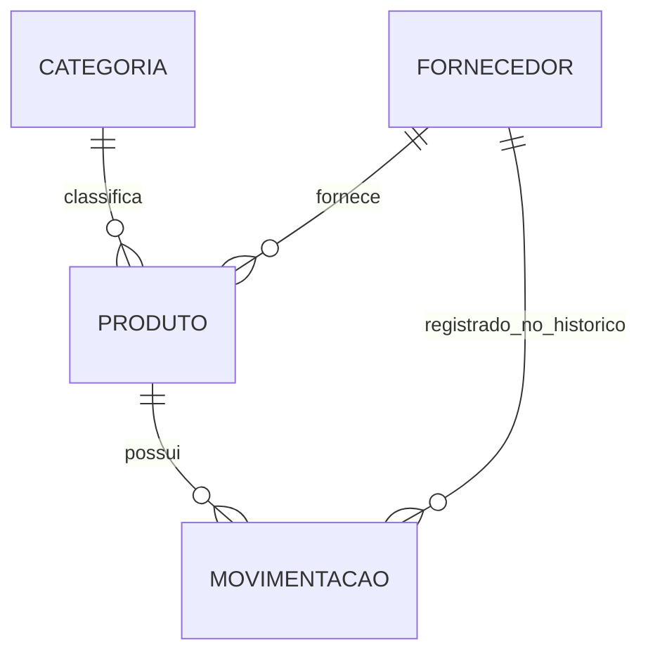

# StockCentral

API de gerenciamento de estoque desenvolvida para o desafio Back-End da Ecomp Jr.
Centraliza produtos, categorias, fornecedores e o histórico de entradas e saídas,
com consultas para acompanhar o saldo e identificar necessidades de reposição.

## Tecnologias

- Python 3.13, FastAPI e Uvicorn.
- PostgreSQL 18, executado com Docker Compose.
- SQLAlchemy e Psycopg para persistência; Alembic para migrações.
- Pydantic para validação e configurações.
- Pytest, HTTPX e GitHub Actions para testes.

As versões das dependências estão fixadas em `requirements.txt`.

## Instalação e execução

### Requisitos

- Git e Python 3.13.
- Docker Engine e Docker Compose disponíveis no WSL, para o fluxo Windows abaixo.
- Porta `5444` disponível para o banco e `8000` para a API.

O Compose executa somente o PostgreSQL. A API é executada pelo Python local.
Não é necessário instalar PostgreSQL diretamente no Windows.

### 1. Obter o projeto — PowerShell

```powershell
git clone https://github.com/enejota-njs/StockCentral.git
cd StockCentral
```

Todos os comandos seguintes são executados na **raiz do repositório**, onde ficam
`README.md`, `requirements.txt` e `compose.yaml`.

### 2. Preparar o Python — PowerShell

```powershell
python -m venv .venv
.\.venv\Scripts\python.exe -m pip install -r requirements.txt
```

O primeiro comando cria o ambiente virtual; só precisa ser executado na primeira
instalação. Os demais comandos chamam o Python da `.venv` diretamente: não é
necessário ativar o ambiente nem entrar na pasta `.venv`.

### 3. Configurar o banco — PowerShell

Na primeira configuração:

```powershell
Copy-Item .env.example .env
```

Preencha `POSTGRES_PASSWORD` no `.env`. Preserve um `.env` que já esteja configurado;
não repita a cópia sobre ele. Esse arquivo é ignorado pelo Git.

| Variável | Valor local / finalidade |
| --- | --- |
| `POSTGRES_DB` | `stockcentral`: nome do banco |
| `POSTGRES_USER` | `postgres`: usuário do banco local |
| `POSTGRES_PASSWORD` | Senha escolhida na configuração |
| `POSTGRES_HOST` | `127.0.0.1`: acesso da API ao banco |
| `POSTGRES_PORT` | `5444`: porta publicada pelo Docker |

### 4. Iniciar o PostgreSQL — WSL

Abra um terminal WSL na pasta do repositório. Para um projeto no Windows, o caminho
`C:\Users\seu_usuario\dev\StockCentral` corresponde a
`/mnt/c/Users/seu_usuario/dev/StockCentral` no WSL. Ajuste o caminho à sua instalação.

```bash
docker compose up -d
docker compose ps
```

Mantenha o WSL em execução durante o uso da API. Também é possível executar
`docker compose up`, sem `-d`, para acompanhar os logs em primeiro plano.

O banco fica acessível em `127.0.0.1:5444`; a porta interna do contêiner é `5432`.
Os dados persistem no volume `postgres_data`. Para trocar a porta local, altere o
lado esquerdo do mapeamento em `compose.yaml` e `POSTGRES_PORT` no `.env`, mantendo
`5432` como porta interna, e execute `docker compose up -d` novamente.

### 5. Aplicar migrações e iniciar a API — PowerShell

```powershell
.\.venv\Scripts\python.exe -m alembic upgrade head
.\.venv\Scripts\python.exe -m uvicorn app.main:app --reload
```

O Alembic aplica somente as migrações pendentes. `--reload` recarrega a aplicação
quando o código muda e é destinado ao desenvolvimento.

| Endereço local | Uso |
| --- | --- |
| [Swagger UI](http://127.0.0.1:8000/docs) | Documentação interativa e execução das rotas |
| [OpenAPI](http://127.0.0.1:8000/openapi.json) | Contrato da API em JSON |
| [Health](http://127.0.0.1:8000/health) | Verificação da aplicação |
| [Health do banco](http://127.0.0.1:8000/health/db) | Verificação da conexão com PostgreSQL |

Para parar a API, use `Ctrl+C`. Para parar o banco sem remover os dados, execute
`docker compose stop` no WSL. O comando `docker compose down -v` remove o volume
com os dados e não deve ser usado apenas para parar o serviço.

### Linux ou execução inteiramente no WSL

Use um ambiente virtual criado no próprio Linux, separado do ambiente do Windows:

```bash
python3.13 -m venv .venv
.venv/bin/python -m pip install -r requirements.txt
cp .env.example .env
```

Configure a senha no `.env` antes de iniciar os serviços:

```bash
docker compose up -d
.venv/bin/python -m alembic upgrade head
.venv/bin/python -m uvicorn app.main:app --reload
```

Nessa configuração, os comandos são executados na raiz do projeto no terminal Linux.
A cópia do `.env` também é feita somente na primeira configuração.

## Modelo de dados e regras de negócio



- Cada produto pertence a uma categoria e a um fornecedor.
- Categorias têm nome único, sem distinguir maiúsculas/minúsculas.
- Fornecedores têm CNPJ e email únicos. A comparação de email ignora maiúsculas/minúsculas.
- Produtos têm SKU único, salvo em maiúsculas, e preços com duas casas decimais.
- Produtos começam com saldo zero. Apenas movimentações alteram o saldo pela API.
- Uma entrada soma ao saldo; uma saída subtrai e exige quantidade disponível.
- Movimentações são criadas e consultadas; a API não permite editá-las ou excluí-las.
- O fornecedor é copiado do produto para a movimentação. Uma troca posterior no
  cadastro do produto preserva o fornecedor das operações anteriores.
- Chaves estrangeiras com `RESTRICT` impedem excluir categorias com produtos,
  fornecedores com produtos ou histórico e produtos com movimentações.

### Transações e concorrência

A criação de uma movimentação usa uma única transação para gravar o histórico e
atualizar o produto. Uma falha desfaz as duas alterações.

Antes de calcular o saldo, a aplicação consulta o produto com `SELECT ... FOR UPDATE`.
Outra movimentação do mesmo produto aguarda a liberação dessa linha e então usa o
saldo atualizado. Isso evita que duas saídas consumam a mesma unidade ou que uma
entrada sobrescreva o resultado de outra. Produtos diferentes podem ser movimentados
em paralelo.

A proteção vale para as operações realizadas pela API. Inserções manuais na tabela
de movimentações não executam a lógica de atualização de saldo.

## Referência da API

URL base local: `http://127.0.0.1:8000`. Os corpos são JSON. Os exemplos usam IDs e
datas ilustrativos: substitua os IDs pelos valores retornados no seu cadastro.

POST cria um registro e retorna `201`. PUT substitui os campos editáveis e exige
o corpo completo. GET retorna `200`. DELETE bem-sucedido retorna `204`, sem corpo.
Os corpos de cadastro rejeitam campos desconhecidos.

As listagens retornam arrays, ou `[]` quando não há resultados. Todas aceitam
`offset` (inteiro >= 0, padrão 0) e `limit` (1 a 100, padrão 50).

### Categorias

| Método | Caminho | Entrada | Resposta de sucesso | Erros específicos |
| --- | --- | --- | --- | --- |
| POST | `/categorias` | Corpo com `nome` | 201, categoria | 409: nome duplicado |
| GET | `/categorias` | `offset`, `limit` | 200, array de categorias | 422: paginação inválida |
| GET | `/categorias/{category_id}` | ID positivo | 200, categoria | 404: inexistente |
| PUT | `/categorias/{category_id}` | ID e corpo com `nome` | 200, categoria | 404: inexistente; 409: duplicata |
| DELETE | `/categorias/{category_id}` | ID positivo | 204 | 404: inexistente; 409: categoria vinculada |

Corpo de POST e PUT:

```json
{"nome": "Papelaria"}
```

Resposta de POST, PUT e GET individual:

```json
{"id": 1, "nome": "Papelaria"}
```

O nome deve ter de 1 a 100 caracteres após remover espaços nas pontas.
`Papelaria` e `PAPELARIA` são considerados iguais. A listagem é ordenada pelo ID crescente.

### Fornecedores

| Método | Caminho | Entrada | Resposta de sucesso | Erros específicos |
| --- | --- | --- | --- | --- |
| POST | `/fornecedores` | Corpo de fornecedor | 201, fornecedor | 409: CNPJ ou email duplicado |
| GET | `/fornecedores` | `offset`, `limit` | 200, array de fornecedores | 422: paginação inválida |
| GET | `/fornecedores/{supplier_id}` | ID positivo | 200, fornecedor | 404: inexistente |
| PUT | `/fornecedores/{supplier_id}` | ID e corpo completo | 200, fornecedor | 404: inexistente; 409: duplicata |
| DELETE | `/fornecedores/{supplier_id}` | ID positivo | 204 | 404: inexistente; 409: fornecedor vinculado |

Corpo de POST e PUT:

```json
{
  "nome": "Fornecedor de exemplo",
  "cnpj": "12.ABC.345/01DE-35",
  "email": "contato@example.com",
  "telefone": "(75) 99999-1234"
}
```

Resposta de POST, PUT e GET individual:

```json
{
  "id": 1,
  "nome": "Fornecedor de exemplo",
  "cnpj": "12ABC34501DE35",
  "email": "contato@example.com",
  "telefone": "(75) 99999-1234"
}
```

Todos os campos são obrigatórios. Regras:

- Nome: 1 a 150 caracteres, sem espaços nas pontas; pode se repetir.
- CNPJ: formato numérico ou alfanumérico, com máscara completa ou sem pontuação.
  Os dígitos verificadores são validados; o armazenamento usa 14 caracteres sem
  máscara e em maiúsculas. A validação não consulta a situação cadastral da empresa.
  O exemplo alfanumérico segue o [manual da Receita Federal](https://www.gov.br/receitafederal/pt-br/centrais-de-conteudo/publicacoes/documentos-tecnicos/cnpj/manual-dv-cnpj.pdf).
- Email: formato validado pelo Pydantic, salvo em minúsculas, com até 254 caracteres.
  Não verifica a existência da caixa de email.
- Telefone: 8 a 15 dígitos e até 30 caracteres no total. Aceita espaços,
  parênteses, ponto, hífen e `+` inicial; preserva a formatação sem espaços nas pontas.

A listagem é ordenada pelo ID crescente.

### Produtos

| Método | Caminho | Entrada | Resposta de sucesso | Erros específicos |
| --- | --- | --- | --- | --- |
| POST | `/produtos` | Corpo de produto | 201, produto com saldo zero | 409: SKU duplicado; 422: vínculo inválido |
| GET | `/produtos` | Paginação e filtros abaixo | 200, array de produtos | 422: filtro inválido |
| GET | `/produtos/{product_id}` | ID positivo | 200, produto | 404: inexistente |
| PUT | `/produtos/{product_id}` | ID e corpo completo | 200, produto | 404: inexistente; 409: duplicata; 422: vínculo inválido |
| DELETE | `/produtos/{product_id}` | ID positivo | 204 | 404: inexistente; 409: produto com histórico |

Corpo de POST e PUT, usando categoria e fornecedor já cadastrados:

```json
{
  "nome": "Caneta azul",
  "sku": "CANETA-001",
  "preco_custo": "2.50",
  "preco_venda": "4.90",
  "estoque_minimo": 5,
  "categoria_id": 1,
  "fornecedor_id": 1
}
```

Resposta de POST, PUT e GET individual:

```json
{
  "id": 1,
  "nome": "Caneta azul",
  "sku": "CANETA-001",
  "preco_custo": "2.50",
  "preco_venda": "4.90",
  "quantidade_em_estoque": 0,
  "estoque_minimo": 5,
  "data_cadastro": "2026-10-19T12:00:00Z",
  "categoria_id": 1,
  "fornecedor_id": 1
}
```

Todos os sete campos de entrada são obrigatórios. Regras:

- Nome: 1 a 150 caracteres após remover espaços nas pontas.
- SKU: 1 a 64 caracteres, começando por letra ou número. Aceita letras ASCII,
  números, ponto, hífen e sublinhado. É convertido para maiúsculas.
- Preços: entre zero e `9999999999.99`, com até duas casas decimais. São usados
  `Decimal` no Python e `Numeric(12, 2)` no banco. As respostas representam preços
  como strings. A entrada aceita strings com ponto decimal ou números JSON.
- O preço de venda pode ser inferior ao custo, permitindo descontos e liquidações.
- Estoque mínimo: inteiro de 0 a 2147483647.
- Categoria e fornecedor: IDs inteiros positivos de cadastros existentes.
- `id`, `data_cadastro` e `quantidade_em_estoque` são somente leitura; enviá-los
  no POST ou PUT retorna 422. A edição preserva o saldo e a data de cadastro.

Filtros de `GET /produtos`, combináveis entre si e com a paginação:

| Parâmetro | Significado |
| --- | --- |
| `categoria_id` | Produtos da categoria informada |
| `fornecedor_id` | Produtos atualmente vinculados ao fornecedor |
| `estoque_baixo=true` | Saldo igual ou inferior ao estoque mínimo |
| `estoque_baixo=false` | Saldo superior ao estoque mínimo |

Sem `estoque_baixo`, ambos os grupos são retornados. Os filtros são aplicados antes
da paginação; a ordem é pelo ID crescente. Filtros sem correspondência retornam `[]`.

```text
GET /produtos?estoque_baixo=true
GET /produtos?categoria_id=1&fornecedor_id=1&offset=0&limit=10
```

### Movimentações

| Método | Caminho | Entrada | Resposta de sucesso | Erros específicos |
| --- | --- | --- | --- | --- |
| POST | `/movimentacoes` | Produto, tipo e quantidade | 201, movimentação | 404: produto inexistente; 409: saldo insuficiente ou limite excedido |
| GET | `/movimentacoes` | Paginação e filtros abaixo | 200, array de movimentações | 422: filtros ou período inválidos |
| GET | `/movimentacoes/{movement_id}` | ID positivo | 200, movimentação | 404: inexistente |

Corpo de POST:

```json
{"produto_id": 1, "tipo": "entrada", "quantidade": 10}
```

Para retirar unidades, use `"tipo": "saida"`. Quantidade é um inteiro entre 1 e
2147483647; o saldo resultante também precisa estar entre 0 e 2147483647.
O servidor determina o fornecedor e a data. Esses campos não são aceitos no corpo.

Resposta de POST e GET individual:

```json
{
  "id": 1,
  "produto_id": 1,
  "fornecedor_id": 1,
  "tipo": "entrada",
  "quantidade": 10,
  "data": "2026-10-19T12:00:00Z"
}
```

PUT, PATCH e DELETE em `/movimentacoes/{movement_id}` retornam 405 e não alteram
histórico nem saldo.

Filtros de `GET /movimentacoes`:

| Parâmetro | Significado |
| --- | --- |
| `produto_id` | Produto da movimentação |
| `fornecedor_id` | Fornecedor registrado no histórico, não necessariamente o atual do produto |
| `tipo` | `entrada` ou `saida` |
| `data_inicio` | Data e hora inicial, inclusiva, com fuso |
| `data_fim` | Data e hora final, inclusiva, com fuso |
| `offset`, `limit` | Paginação, com os mesmos limites das outras listagens |

É possível enviar somente uma das datas. Quando ambas são informadas, o início
não pode ser posterior ao fim. Use ISO 8601 com `Z` (UTC) ou um deslocamento como
`-03:00`. Um `+` em uma URL deve ser codificado como `%2B`; o Swagger faz isso.
Parâmetros desconhecidos nesta consulta são rejeitados.

A ordem é por data decrescente, com desempate pelo ID decrescente. Os filtros são
aplicados antes da paginação. Filtros sem correspondência retornam `[]`.

```text
GET /movimentacoes?tipo=saida&produto_id=1
GET /movimentacoes?fornecedor_id=1&offset=0&limit=10
GET /movimentacoes?data_inicio=2026-10-19T00:00:00-03:00&data_fim=2026-10-19T23:59:59.999999-03:00
```

### Verificações de funcionamento

| Método | Caminho | Sucesso | Falha |
| --- | --- | --- | --- |
| GET | `/health` | 200, `{"status":"ok"}` | Não verifica o banco |
| GET | `/health/db` | 200, `{"status":"ok","database":"ok"}` | 503, `{"detail":"Banco de dados indisponivel."}` |

## Respostas de erro

Além dos erros específicos nas tabelas, as rotas de dados podem retornar 422 para
corpos, IDs ou parâmetros inválidos, 503 para falhas operacionais do banco e 500
para erros internos. IDs de fornecedores, produtos e movimentações têm limite de
2147483647. Uma escrita rejeitada desfaz sua transação.

Os erros de negócio usam `detail` como texto:

```json
{"detail": "Estoque insuficiente para essa saida."}
```

| Status | Exemplos de `detail` |
| --- | --- |
| 404 | `Categoria nao encontrada.`, `Fornecedor nao encontrado.`, `Produto nao encontrado.`, `Movimentacao nao encontrada.` |
| 409 | `Ja existe uma categoria com esse nome.`, `Ja existe um fornecedor com esse CNPJ.`, `Ja existe um fornecedor com esse email.`, `Ja existe um produto com esse SKU.` |
| 409 | `Categoria vinculada a outros registros nao pode ser excluida.`, `Fornecedor vinculado a outros registros nao pode ser excluido.`, `Produto vinculado a outros registros nao pode ser excluido.` |
| 409 | `Estoque insuficiente para essa saida.`, `Limite de quantidade em estoque excedido.` |
| 422 | `Categoria informada nao existe.`, `Fornecedor informado nao existe.` |
| 500 | `Erro interno ao acessar o banco de dados.` ou `Erro interno do servidor.` |
| 503 | `Banco de dados indisponivel.` |

Erros de validação do FastAPI usam 422 e uma lista em `detail`. Exemplo de corpo
sem o campo obrigatório `nome`:

```json
{
  "detail": [
    {"type": "missing", "loc": ["body", "nome"], "msg": "Field required", "input": {}}
  ]
}
```

O campo `loc` indica a origem: `body`, `path` ou `query`. Métodos não permitidos
retornam `405` com `{"detail":"Method Not Allowed"}`. Exceções internas não expõem
SQL, credenciais ou stack traces nas respostas.

## Roteiro de uso no Swagger

1. Abra `/docs` e use **Try it out** nas rotas.
2. Cadastre uma categoria e um fornecedor com os exemplos acima; anote os IDs.
3. Cadastre um produto usando esses IDs. Seu saldo inicial será zero.
4. Registre uma entrada de 10 unidades e uma saída de 3 para esse produto.
5. Consulte o produto: o saldo será 7. Consulte `/movimentacoes` pelo `produto_id`.
6. Tente uma saída de 8: a resposta será 409 e o saldo permanecerá 7.
7. Tente excluir o produto: a resposta será 409, pois existe histórico vinculado.
8. Consulte `/produtos?estoque_baixo=true` para encontrar itens que precisam de reposição.

Esse roteiro cria dados no banco usado pela aplicação. Os testes automatizados,
por sua vez, usam schemas isolados.

## Testes e integração contínua

No PowerShell, com PostgreSQL em execução e `.env` configurado:

```powershell
.\.venv\Scripts\python.exe -m pip check
.\.venv\Scripts\python.exe -m pytest -q
.\.venv\Scripts\python.exe -m alembic check
```

No Linux, substitua `.\.venv\Scripts\python.exe` por `.venv/bin/python`.

A suíte cobre CRUD, validações, unicidade, chaves estrangeiras, migrações, filtros,
limites de datas, imutabilidade pela API, reversão de operações com falha, logs e
movimentações simultâneas. O banco de testes precisa permitir criação de schemas;
a conta local `postgres` possui essa permissão.

A maioria dos testes cria um schema temporário e reverte sua transação externa.
Os testes de concorrência usam schemas próprios, conexões independentes e dados
confirmados para observar bloqueios reais; removem esses schemas ao terminar.
Use um banco local ou dedicado a testes, não um banco de produção.

O workflow [tests.yml](.github/workflows/tests.yml) roda em pushes e pull requests,
com Python 3.13 e PostgreSQL 18. Ele instala as dependências, verifica sua
compatibilidade, aplica as migrações, compara os modelos e executa a suíte.
Os resultados ficam em [GitHub Actions](https://github.com/enejota-njs/StockCentral/actions).

## Logs

A aplicação emite logs JSON no terminal. Requisições registram método, template da
rota, status e tempo até a resposta, em milissegundos. Exemplo ilustrativo:

```json
{"timestamp":"2026-10-19T12:00:00+00:00","level":"INFO","logger":"app.http","message":"http_request","method":"GET","route":"/produtos/{product_id}","status_code":200,"duration_ms":3.2}
```

Erros registram o tipo da exceção, sem seu conteúdo interno. Os logs da aplicação
não incluem corpos, headers ou valores da query string. As mensagens próprias do
servidor Uvicorn são separadas dos logs JSON da aplicação.

## Organização do projeto

| Caminho | Responsabilidade |
| --- | --- |
| `app/main.py` | Aplicação, registro de rotas, middleware e health checks |
| `app/config.py` | Configurações lidas do ambiente e do `.env` |
| `app/database.py` | Conexão, sessões e base dos modelos |
| `app/models.py` | Tabelas, índices e restrições |
| `app/schemas.py` | Validação de entradas, filtros e modelos de resposta |
| `app/validators.py` | Validação de CNPJ e telefone |
| `app/routers/` | Operações HTTP e regras transacionais |
| `app/errors.py` | Respostas para falhas de banco e erros inesperados |
| `app/observability.py` | Formatação JSON e registro das requisições |
| `migrations/` | Histórico versionado da estrutura do banco |
| `tests/` | Testes automatizados e preparação dos ambientes isolados |
| `.github/workflows/tests.yml` | Pipeline de integração contínua |
| `compose.yaml` | PostgreSQL local e volume persistente |

## Solução de problemas

- **Banco indisponível:** confira `docker compose ps` e `docker compose logs --tail 30 db`
  no WSL. No PowerShell, teste a porta com `Test-NetConnection 127.0.0.1 -Port 5444`.
- **Senha não aceita:** alterar `POSTGRES_PASSWORD` no `.env` após a primeira criação
  do volume não altera a senha já gravada no PostgreSQL.
- **Tabela inexistente:** execute `python -m alembic upgrade head` com o Python da
  `.venv` e a configuração do banco correto.
- **Configuração não encontrada:** execute os comandos na raiz do repositório,
  confira o `.env` e preencha todas as variáveis de `.env.example`.
- **Porta ocupada:** ajuste a porta publicada no Compose e `POSTGRES_PORT` juntos.
  Para a API, é possível usar `--port 8001` no comando do Uvicorn.

A API não utiliza autenticação: as rotas estão disponíveis sem login. A execução
local documentada usa interfaces de loopback para a API e para a porta do banco.
